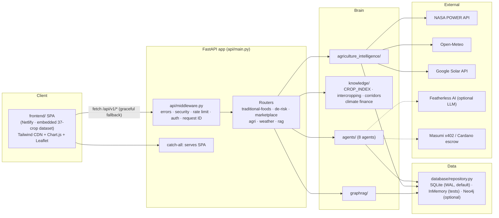

<h1 align="center">🌿 Kienyeji</h1>

<p align="center">
  <strong>Traditional Food Intelligence for Kenya</strong> — classifying the foods Nairobians eat by origin, mapping indigenous crops to counties, corridors, and climate-finance de-risking data.
</p>

<p align="center">
  <a href="https://github.com/geraldkombo/kcw/actions/workflows/ci.yml"></a>
  
  
  
  
</p>

<p align="center">
  <a href="https://kienyeji.netlify.app"><strong>Live demo → kienyeji.netlify.app</strong></a> (standalone SPA, no backend required)
</p>

---

## Why

Of the ~680 foods eaten by Nairobians, only about a third actually originate in Kenya — the rest are exotic introductions. Kenya's indigenous food system is also invisible in national data: 57% post-harvest loss, a $225M USAID funding gap, and 9 food corridors that operate entirely outside formal markets.

**Kienyeji** makes the indigenous half visible and investable. It is a Python/FastAPI intelligence system plus a no-build SPA that answers *"what should I grow, where, with whom, and how is it de-risked?"* using satellite climate data, agronomic knowledge, market references, and climate-finance instruments.

Built for **Track 4 — Data and Decision Support** (Mercy Corps AgriFin AI for Agriculture — Kenya AI Challenge), with the Lake Region as the narrative anchor.

## What it does

| Area | Module | What you get |
| --- | --- | --- |
| 🌾 Traditional foods knowledge | `knowledge/traditional_foods.py` | `CROP_INDEX` of 34 crops classified indigenous / naturalised / exotic, each with resilience score (Rs 0.0–1.0), Swahili + local names, counties, traditional uses, nutrition, GDD base temp, water needs, and market context; 12 intercropping patterns with row ratios and yield-boost data; 9 food corridors (incl. 2 cross-border: Busia–Uganda, Namanga–Tanzania); mineral profiles for 7 crops |
| 💰 Climate finance & de-risking | `knowledge/climate_finance.py` | Parametric insurance model (satellite triggers, ~10-day payout), $772M green bond framework, USAID freeze impact, 57% post-harvest-loss analytics, carbon-credit potential, cross-border trade context (77% women traders) |
| 🛰️ Satellite & weather | `satellite/` | NASA POWER client (soil moisture, temperature, solar, precipitation — free, no auth), Open-Meteo client (7-day forecast + ERA5 reanalysis from 1940), Google Solar API client |
| 🧠 Agricultural intelligence | `agriculture_intelligence/` | Land suitability, precision farming (GDD thresholds, ET, pest risk, micro-climate, irrigation timing), market intelligence (reference prices, retail markups, value-added pricing), water & solar optimisers, seed quality, cooperative tools |
| 🕸️ GraphRAG | `graphrag/service.py` | Query engine over 100 known crop names/variants with POLE (Person–Object–Location–Event) traversal |
| 🤖 Agents | `agents/` | 8 analysis agents: Land Intelligence, Precision Farming, Market Intelligence, Macro-Climatic, Cooperative, Geo Audit, Investment Advisor, Verification |
| 🛒 Marketplace | `api/routes/marketplace.py` | Browse/post/delete listings, per-listing de-risk analysis, reference prices |
| 🖥️ Frontend SPA | `frontend/` | 5 pages — Dashboard, Traditional Foods, Corridors, Marketplace, De-Risk. No build step: Tailwind CSS (CDN) + Chart.js + Leaflet, dark mode, EN/SW i18n |

### REST API surface

52 endpoints across 6 routers (full schema at `/docs` when running):

| Prefix | Router | Endpoints |
| --- | --- | --- |
| `/api/v1/traditional-foods` | `api/routes/traditional_foods.py` | 8 — classify crop, crops by region/county, full list, intercropping, corridors, resilience, nutrition + minerals |
| `/api/v1/de-risk` | `api/routes/climate_finance.py` | 6 — overview, parametrics, green bond, USAID impact, post-harvest loss, carbon credits |
| `/api/v1/marketplace` | `api/routes/marketplace.py` | 6 — listings (GET/POST/GET-one/DELETE), listing de-risk, prices |
| `/api/v1/agri` | `api/routes/agriculture_intelligence.py` | 22 — land suitability, market intelligence, precision farming (GDD, ET, pest risk, micro-climate, irrigation timing, climate resilience), solar/water by coordinates, idle land, seed recommendation, cooperative tools, contract farming search |
| `/weather` | `api/routes/weather.py` | 7 — forecast (+ temperature/precipitation/humidity/wind slices), ERA5 reanalysis, solar environment |
| `/api/v1/rag` | `api/routes/rag.py` | 3 — GraphRAG query + POLE traversal |

Plus `/health`, `/ready`, `/api/v1/config`, and a catch-all that serves the SPA. Cross-cutting concerns live in `api/middleware.py`: error handling, security headers, rate limiting, optional API-key auth, and request IDs.

## Architecture



The deployed Netlify SPA runs **fully standalone**: it ships with an embedded dataset and only opportunistically calls `/api/v1/*`, degrading gracefully when no backend is attached. Run the FastAPI app locally and it serves both the API and the same SPA from one port.

## Quickstart

Requirements: **Python 3.12** (CI runs 3.12; `pyproject.toml` targets py312).

```bash
git clone https://github.com/geraldkombo/kcw.git
cd kcw

python -m venv .venv
source .venv/bin/activate        # Windows: .venv\Scripts\activate
pip install -r requirements.txt

# API + SPA on one port
uvicorn api.main:app --reload
```

Open <http://localhost:8000> for the dashboard, <http://localhost:8000/docs> for Swagger. SQLite is the default store (`data/frk.db`, WAL mode, auto-migrated on connect); no external services are required to boot. Optional keys (Featherless, Masumi, Google Solar, Neo4j) are read from `.env` — see `.env.example`; everything degrades gracefully when unset.

### Tests

```bash
python -m pytest tests/ -q
# 150 passed
```

CI additionally runs with deprecation warnings as errors (`python -m pytest tests/ -v -W error::DeprecationWarning`), plus `ruff` lint/format and `mypy` (see `.github/workflows/ci.yml`). Test modules cover traditional foods (index + API), climate finance, GraphRAG, precision farming, weather clients, and infrastructure (settings, logging, middleware, health endpoints).

## Docker

Multi-stage `python:3.12-slim` image, non-root `kcw` user, built-in `/health` healthcheck, uvicorn with 4 workers:

```bash
docker build -t kienyeji .
docker run --rm -p 8000:8000 kienyeji
```

`docker-compose.yml` adds nginx (serving `frontend/` with TLS config from `nginx.conf`) in front of 2 API replicas, and an **optional** Neo4j 5 enterprise service behind a profile:

```bash
docker compose up -d              # api + nginx
docker compose --profile neo4j up -d   # + Neo4j graph backend
```

## Deployment

- **Frontend (live):** <https://kienyeji.netlify.app> — the `frontend/` folder deployed to Netlify as a standalone SPA with embedded data. No backend needed; `frontend/netlify.toml` defines SPA redirects plus an optional `/api/v1/*` proxy for when a backend is attached.
- **Backend:** `render.yaml` describes a free-tier Render web service (`frk-api`, Frankfurt) running uvicorn with `/health` checks and CORS pinned to the Netlify origin; `.github/workflows/deploy.yml` triggers a Render deploy hook on pushes to `main`. **Honest status:** the hosted Render instance is not currently running, so the live demo operates in standalone-SPA mode. Point the proxy at your own deployment (Render, Fly, a VM with Docker) to re-enable live API features such as marketplace posting.
- **Neo4j graph (optional):** `neo4j/schema.cypher` and `neo4j/queries.cypher` define and query the graph; `scripts/migrate.py` loads schema into a running Neo4j instance.

## Data sources

| Source | What | Access |
| --- | --- | --- |
| `knowledge/traditional_foods.py` — `CROP_INDEX` | 34 crops with origin/status, resilience scores, counties, intercropping, nutrition. Grounded in Maundu, Ngugi & Kabuye (1999) *Traditional Food Plants of Kenya* (NMK), Maundu et al. (2009) *Biodiversity of African Vegetables*, Kennedy, Wang, Maundu & Hunter (2022, *Trends in Food Science & Technology*), Ojwang (2020, Univ. of Nairobi PhD thesis), Maundu et al. (2005) *Useful Trees and Shrubs for Kenya* (ICRAF), and the NMK Traditional Food Plants database — full citations in the module docstring | Static knowledge layer |
| NASA POWER API | Daily satellite climate data: soil moisture, temperature, solar, precipitation | Free, no auth (`satellite/power_client.py`) |
| Open-Meteo | 7-day forecast + ERA5 reanalysis back to 1940 | Free, no key (`satellite/openmeteo_client.py`) |
| Google Solar API | Rooftop solar potential | Optional key via `GOOGLE_MAPS_API_KEY`; SVG fallback map when unset |
| `agriculture_intelligence/market_intelligence.py` — `MARKET_PRICES` | 39 crop price references + 5 retail-markup profiles + value-added pricing | **Static mid-2026 reference values**, not a live market feed |
| `knowledge/climate_finance.py` | Insurance, green bond, USAID freeze, PHL, carbon credit figures | Static, cited research/policy data |

The SPA's embedded dataset (`frontend/app.js`) covers 37 crops — a superset of the backend index, kept in sync manually.

## Project structure

```
kcw/
├── api/
│   ├── main.py                  # FastAPI app, router registration, SPA serving, /health /ready
│   ├── dependencies.py          # repository dependency injection
│   ├── middleware.py            # errors, security headers, rate limiting, auth, request ID
│   └── routes/                  # agriculture_intelligence · weather · rag · traditional_foods · marketplace · climate_finance
├── agents/                      # 8 agents (land, precision farming, market, macro-climatic,
│                                #   cooperative, geo audit, investment advisor, verification)
├── agriculture_intelligence/    # land suitability, precision farming, market intelligence,
│                                #   water/solar optimisers, seed quality, cooperative tools
├── config/                      # settings.py (Pydantic V2 BaseSettings) · log.py (JSON logging, request IDs)
├── database/                    # repository.py (SQLite/InMemory/Neo4j) · migrations/ (001_initial.sql, cli.py)
├── featherless/                 # optional LLM augmentation client
├── frontend/                    # standalone SPA: index.html · app.js · i18n.js (EN/SW) · netlify.toml
├── graphrag/                    # service.py — crop alias resolution (100 names) + GraphRAG queries
├── knowledge/                   # traditional_foods.py (CROP_INDEX) · climate_finance.py
├── masumi/                      # x402 client, Cardano escrow lifecycle, MIP-003 schemas
├── neo4j/                       # schema.cypher · queries.cypher (optional graph backend)
├── satellite/                   # NASA POWER · Open-Meteo · Google Solar clients
├── scripts/                     # migrate.py (Neo4j) · setup.ps1 · demo scripts
├── services/                    # package placeholder
├── tests/                       # 150 tests across 7 modules
├── .github/workflows/           # ci.yml (lint · typecheck · test · docker build) · deploy.yml (Render hook)
├── Dockerfile · docker-compose.yml · nginx.conf
├── render.yaml                  # backend deploy config
├── requirements.txt · pyproject.toml
├── AGENTS.md                    # agent guide / source of truth for repo conventions
├── FRK_*.md                     # challenge-track docs (pitch, rubric, vision, demo script, research prompt)
└── LICENSE                      # MIT
```

## Contributing

1. Read `AGENTS.md` first — it is the repo's source of truth (conventions, file map, hard rules).
2. Keep the focus: **traditional foods intelligence only** — no farmer-onboarding, loan, credit, or securitisation features (AGENTS.md rule 5).
3. Pydantic V2 patterns only (`model_config`, no legacy `Config` class); `from __future__ import annotations` in new Python files.
4. Run the full suite before opening a PR: `python -m pytest tests/ -v -W error::DeprecationWarning` — all 150 tests must pass with zero deprecation warnings, and `ruff check .` / `mypy` must be clean (mirrors CI).
5. Adding a crop? Extend `CROP_INDEX` in `knowledge/traditional_foods.py` with resilience score, regions, traditional uses, growing requirements, and cited sources — and mirror it in the SPA's embedded dataset.

## License

MIT — see [LICENSE](LICENSE). Copyright (c) 2026 Gerald Kombo.
